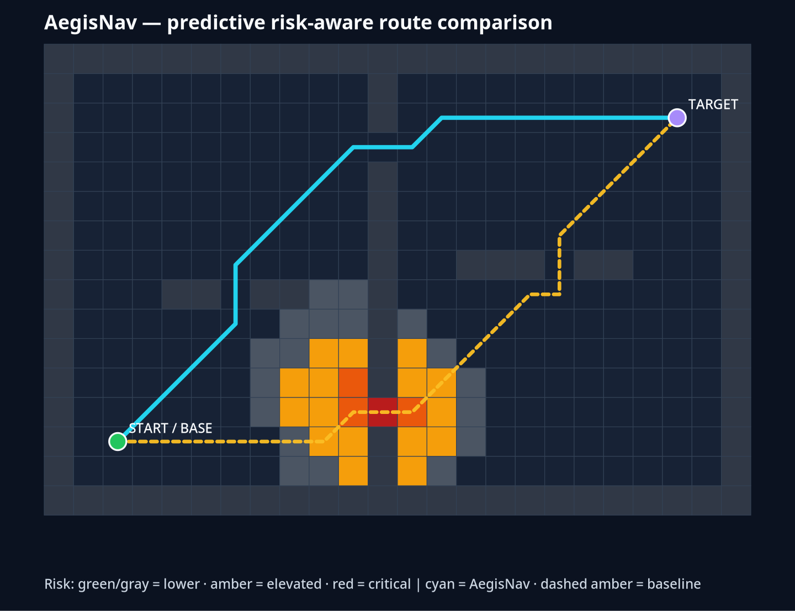
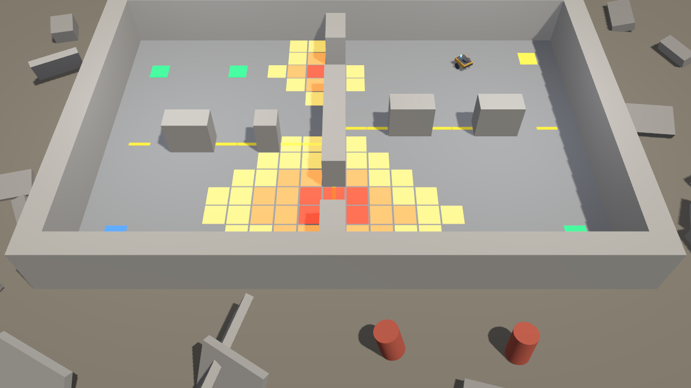
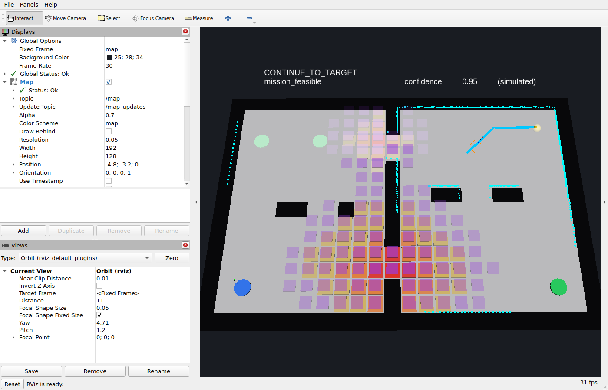
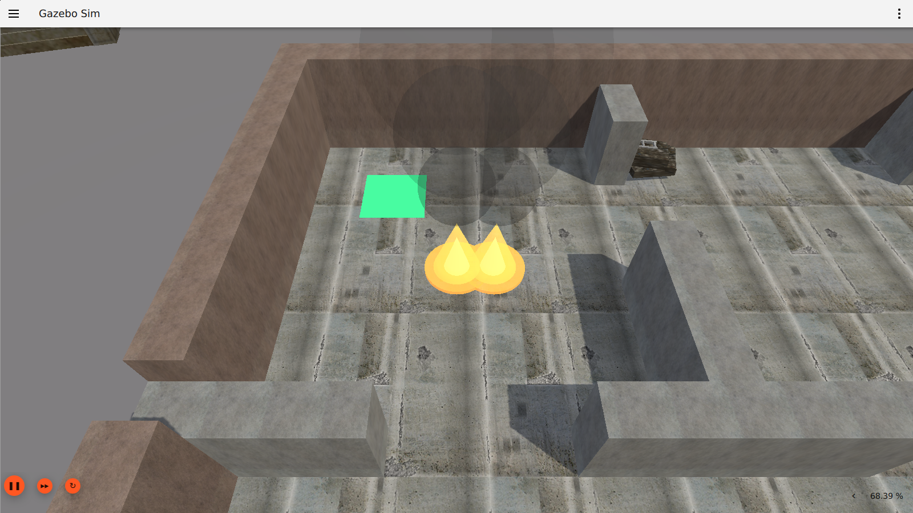
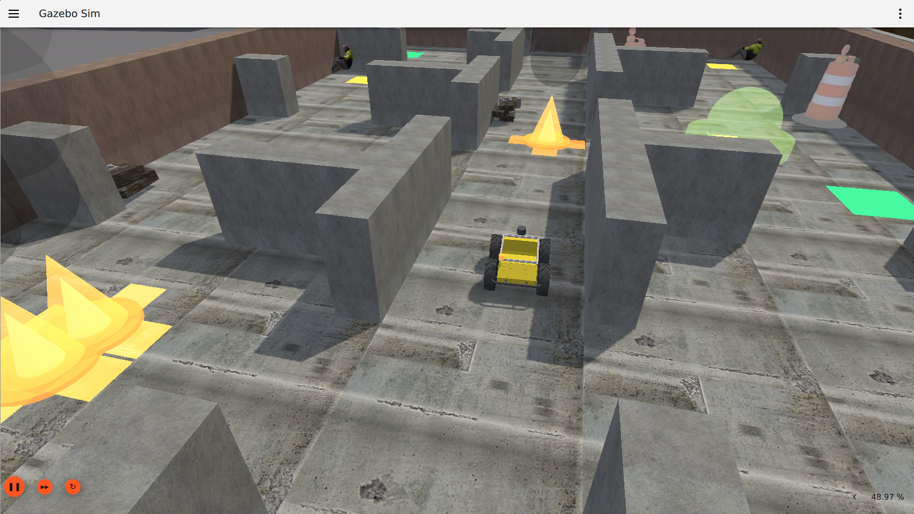

# AegisNav

**Predictive hazard-aware rescue navigation with perception-confidence checks and safe-return assessment.**

AegisNav is a research-grade ROS 2 starter repository for Domain 1.3, *Hazard-Aware Navigation with Dynamic Obstructions*. Its chosen direction is **perception-aware predictive rescue autonomy**: reason about time-indexed synthetic hazards, an explicit sensing-confidence signal, route feasibility on the return journey, refuge selection and auditable decisions. It is built around a deterministic, inspectable planning core first; simulator and ROS 2 integrations live at the edges.

> **Project truth:** this repository is a serious starter implementation, not a finished field-ready rescue robot. The pure-Python core and ROS-message conversion contract tests run without ROS. The ROS 2 workspace build, generated custom-message interface, Gazebo startup, topic bridge behavior, localization integration, and live Nav2 FollowPath execution have **not** been run in the preparation environment and must be validated on an Ubuntu 24.04 / ROS 2 Jazzy / Gazebo Harmonic machine. FollowPath execution is disabled by default for that reason.

## Why this design is different

AegisNav does not just weight a static hazard map. Its core combines:

1. **Time-indexed hazard forecasting** over multiple future layers.
2. **Risk-aware A* path planning** with separate exposure and uncertainty penalties, a hard critical-risk cutoff, and diagonal corner-cutting prevention.
3. **Return feasibility**: a candidate target route is evaluated against a return-to-base route at the predicted arrival time.
4. **Perception-confidence policy**: degraded confidence triggers a safe reassessment mode; critically degraded confidence prefers a low-exposure refuge or a return.
5. **Explainable decisions** as structured reason codes and human-readable explanations.
6. **Deterministic evaluation** against a distance-only baseline, with SVG and JSON artifacts instead of unsupported performance claims.

The hazard model is intentionally labelled **synthetic and non-physical**. It is for reproducible simulation experiments, not for real-world fire dynamics, toxicology, or safety certification.

## Quick start: prove the algorithm before installing ROS

Ubuntu 24.04 includes Python 3.12, which is sufficient for the simulator-independent core.

```bash
cd AegisNav-Starter
./tools/run_core_tests.sh
./tools/run_demo.sh
```

The demo writes:

- `artifacts/demo/aegisnav_route_comparison.svg` — hazard heatmap, risk-aware route, and distance-only baseline.
- `artifacts/demo/metrics.json` — comparable route metrics for the same deterministic scenario.

The report below is a **computed 2D planning artifact**, not a Gazebo camera capture. Cyan shows the risk-aware route; dashed amber shows the distance-only baseline.



No third-party Python package is required for core tests or the demo. The current source-only suite contains 15 core tests and 14 ROS-message adapter contract tests using fake messages; it does not prove live ROS graph or simulator integration.

## Repository map

```text
AegisNav-Starter/
├── AGENTS.md                     # Canonical engineering contract for coding agents
├── agent.md                      # Short agent entrypoint; points to AGENTS.md
├── CONTRIBUTING.md               # Human contributor workflow and acceptance checklist
├── .agent/                       # Agent rules, roles, and implementation workflows
├── .github/                      # Copilot rules, CI quality gate, issue/PR templates
├── docs/                         # Architecture, ADRs, research, setup, safety and runbooks
├── config/aegisnav.yaml           # Human-readable reference config
├── assets/worlds/                 # Source copy of the sample Gazebo SDF world
├── tools/                         # Tests, demo, and repository sanity checks
└── ros2_ws/src/
    ├── aegisnav_core/             # ROS-independent algorithm and unit tests
    ├── aegisnav_msgs/             # Typed HazardForecast interface
    ├── aegisnav_ros/              # ROS 2 forecast/planner adapters and launch config
    └── aegisnav_bringup/           # Gazebo world, occupancy map, bridges and RViz config
```

## System baseline

| Layer | Target |
|---|---|
| OS | Ubuntu 24.04 LTS |
| ROS | ROS 2 Jazzy Jalisco |
| Simulator | Gazebo Harmonic |
| Robotics navigation | Nav2 (optional integration; verify configuration before execution) |
| Core runtime | Python 3.12, standard library only |
| Custom ROS interface | `aegisnav_msgs/msg/HazardForecast` |

The Jazzy/Harmonic pairing is officially supported. See [ROS/Gazebo compatibility](https://gazebosim.org/docs/harmonic/ros_installation/) and [Gazebo Harmonic installation](https://gazebosim.org/docs/harmonic/install_ubuntu/).

## ROS 2 build

Install ROS 2 Jazzy and its desktop packages first. Then install the simulator/navigation dependencies:

```bash
sudo apt update
sudo apt install -y \
  ros-jazzy-ros-gz \
  ros-jazzy-navigation2 \
  ros-jazzy-nav2-bringup \
  ros-jazzy-nav2-map-server \
  ros-jazzy-nav2-lifecycle-manager \
  ros-jazzy-rviz2 \
  python3-colcon-common-extensions
```

Build the workspace:

```bash
source /opt/ros/jazzy/setup.bash
cd ros2_ws
rosdep update
rosdep install --from-paths src --ignore-src -r -y
colcon build --symlink-install
source install/setup.bash
```

Launch the world, `/clock`/sensor bridges, static map, and AegisNav adapters:

```bash
ros2 launch aegisnav_bringup sim_world.launch.py
```

To open RViz overlays too:

```bash
ros2 launch aegisnav_bringup sim_world.launch.py start_rviz:=true
```

This launch starts Gazebo and the hazard forecast/map pieces. It **does not** start AMCL, the complete Nav2 controller stack, or a goal publisher. The planner will wait for a map, forecast, pose on `/amcl_pose`, and target on `/goal_pose`. Read `docs/simulation/setup_ubuntu_jazzy_harmonic.md` before attempting robot motion.

## Topics

| Topic | Type | Meaning |
|---|---|---|
| `/map` | `nav_msgs/msg/OccupancyGrid` | Static traversability map; unknown cells are treated as blocked by default |
| `/aegisnav/hazard_forecast` | `aegisnav_msgs/msg/HazardForecast` | Time-indexed risk and uncertainty layers encoded in occupancy-grid fields |
| `/aegisnav/hazard_markers` | `visualization_msgs/msg/MarkerArray` | Forecast overlay for RViz; it is not rendered into the Gazebo camera |
| `/amcl_pose` | `geometry_msgs/msg/PoseWithCovarianceStamped` | Current robot pose in the map frame (integration prerequisite) |
| `/goal_pose` | `geometry_msgs/msg/PoseStamped` | Requested target pose |
| `/aegisnav/perception_confidence` | `std_msgs/msg/Float32` | Optional simulated confidence input in `[0, 1]`; default is `1.0` until a message arrives |
| `/aegisnav/planned_path` | `nav_msgs/msg/Path` | The selected route for visualization/review |
| `/aegisnav/decision` | `std_msgs/msg/String` | JSON decision trace with action, reason and metrics |

`execute_with_follow_path` is `false` by default. Enable it only after Nav2 controller-server action name, frames, costmaps, localization, and controller/goal-checker IDs have been verified in simulation. An algorithmic path is not by itself a safety guarantee.

## Key engineering boundaries

- `aegisnav_core` must stay ROS-free and deterministic.
- `aegisnav_ros` translates ROS messages to/from core models; it must not contain the route objective or mission policy.
- `aegisnav_msgs` carries contracts, not business logic.
- `aegisnav_bringup` owns simulator assets and launch orchestration.
- The static occupancy map and hazard field are different concepts. A hazard visual does not imply an obstacle, and the planner uses the forecast message rather than the SDF material color.
- Sensor confidence in the sample is a signal supplied by a simulator/test harness. It is not real perception uncertainty estimation.

## Quality gates

```bash
./tools/run_core_tests.sh
./tools/run_demo.sh
./tools/verify_repo.sh
```

Before calling a release reproducible, run the ROS build and live smoke tests on a ROS 2 Jazzy machine. The environment used to prepare this archive does not have ROS/Gazebo/colcon installed, so those integration tests have not been claimed as passed.

## Documentation entry points

- [`AGENTS.md`](AGENTS.md): non-negotiable coding-agent contract.
- [`CONTRIBUTING.md`](CONTRIBUTING.md): required implementation and verification workflow.
- [`docs/architecture/system_overview.md`](docs/architecture/system_overview.md): component graph and data flow.
- [`docs/architecture/feature_direction.md`](docs/architecture/feature_direction.md): brainstormed directions, selected scope and deferred ideas.
- [`docs/architecture/data_contracts.md`](docs/architecture/data_contracts.md): grid/time/confidence conventions.
- [`docs/research/research_position.md`](docs/research/research_position.md): claims, limitations and defensible evaluation plan.
- [`docs/simulation/3d_assets.md`](docs/simulation/3d_assets.md): reuse of disaster-world assets for stronger visuals.
- [`docs/operations/demo_runbook.md`](docs/operations/demo_runbook.md): competition demo sequence and failure plan.
- [`docs/backlog/implementation_plan.md`](docs/backlog/implementation_plan.md): vertical slices and acceptance criteria.

## License and reuse

AegisNav starter code and authored sample world are provided under Apache-2.0. No external disaster-world assets are bundled. Review the license and model availability of any upstream environment before copying or redistributing its assets.

## Closed-loop study without ROS (added 2026-10-29)

`./tools/run_eval.sh 20 0` runs 20 seeded baseline-vs-AegisNav trials in a kinematic abstraction and writes `artifacts/eval/`. Results and caveats: `docs/simulation/closed_loop_evaluation.md`. The live Gazebo/Nav2 path is still unverified on any machine; the development host (Ubuntu 26.04) cannot run Jazzy.

## Live simulation (ROS 2 Jazzy + Gazebo Harmonic + Nav2), verified 2026-10-29

One command on Ubuntu 24.04 with ROS 2 Jazzy, `ros-jazzy-ros-gz` and `ros-jazzy-navigation2` installed, after `colcon build --symlink-install && source install/setup.bash`:

```bash
ros2 launch aegisnav_bringup sim_world.launch.py seed:=7 start_rviz:=true
```
Stop with Ctrl-C, then `pkill -f "gz sim"` if a `gz` process remains. Use `headless:=true` without a display.

What this was verified to do (headless, in the `aegisnav-jazzy` container, see `docs/testing/verification_matrix.md`): seed 7 reroutes at the ignition, switches to `slow_and_reassess` at the confidence drop, and drives to the refuge; seed 3 drives to the target and back to base. Not yet verified: RViz/GUI rendering and frame rate on the RTX 2050, video capture, 20-trial statistics inside Gazebo.

No ROS install? `tools/docker/` builds the same environment (`Dockerfile.jazzy`) and runs the smoke tests; see `docs/simulation/ros_smoke_test.md`.

### What it looks like (genuine renders, headless software rendering — not GPU, not edited)

Gazebo, seed 7, about 20 s in: the hazard tiles are the planner's current forecast layer (amber/orange/red = risk ≥ 0.25/0.5/0.75); green = refuges, blue = base, gold = target.



RViz: current hazard (warm), predicted +10 s (violet), AegisNav path (cyan), robot footprint (orange), decision overlay.



Regenerate: `tools/docker/capture_demo.sh` via `tools/docker/run_in_jazzy.sh` (see `docs/simulation/ros_smoke_test.md`).

### GUI on a host without ROS (e.g. this Ubuntu 26.04 laptop)

```bash
tools/run_gui.sh sandbox      # robot runs the rescue mission; you add fires/goals/confidence
tools/run_gui.sh demo         # scripted fire (8 s) and confidence drop (105 s), for recording
```
This runs Gazebo from the `aegisnav-jazzy` container on your desktop (X11/XWayland). The default world is `rescue_building`:
- a 20 × 14 m damaged building generated from the core scenario grid;
- a Husky robot;
- CC0 props and victims;
- forecast-driven hazard tiles and source markers.

The operator console is at **http://localhost:8080**, published to localhost only. It shows the route, the hazard-ignoring shortest route, the decision and its reason, mission progress and the event log. You can also start a fire, set a goal or change the simulated confidence from it. `WORLD=corridor` selects the original small test world; `RVIZ=true` also opens RViz.

**Larger area, robot discovers hazards itself:** `WORLD=rescue_compound SENSING=true tools/run_gui.sh demo`.
- A 36 × 22 m compound: the building plus a courtyard, a yard and a warehouse, with five inspection points.
- The robot only knows hazards and victims its simulated 4 m line-of-sight sensor has seen.
- It picks the next point by the safest route.
- Its confidence is computed from view and localization quality.

Verified in a full headless mission in the container (ADR-0008, verification matrix), not yet on the laptop. The test card is `docs/operations/try_it.md`, and the design is in ADR-0007.

Rendering: on the integrated Intel GPU via `/dev/dri` (Mesa) unless the NVIDIA Container Toolkit is installed. Installing that toolkit is a system change you make yourself — NVIDIA's install guide: https://docs.nvidia.com/datacenter/cloud-native/container-toolkit/latest/install-guide.html. Stop with Ctrl-C.

Verified so far in the container (headless and with the Gazebo GUI under Xvfb on the Intel GPU):
- the mission sequence;
- a reroute after a fire placed from the console;
- the director camera.

Genuine frames from the Gazebo GUI (Xvfb in the container, Intel GPU via Mesa, not edited). The first shows the director's cut-away to the scripted doorway fire. The second shows the chase camera after the reroute through the middle room, with the fire behind on the left and the gas leak haze on the right.




Not yet measured: frame rate on the laptop's display, and a 20-trial study in this world (the 20-trial study covers the corridor scenario in the kinematic runner).

## Evidence: repeated full missions (2026-11-17)

`tools/run_batch.sh` runs complete headless Gazebo/Nav2 missions in isolated containers with seeded random fires and measures exposure against the **real** hazard field. On 6 matched seeds, AegisNav with onboard sensing completed 6/6 missions and never entered a cell at risk ≥ 0.92 (0/6); a hazard-blind shortest-path baseline entered one in 6/6 runs, briefly, and completed 5/6. Mean exposure 6.7 ± 2.7 against 16.8 ± 6.2 risk·s (paired difference −10.1, 95% bootstrap CI −14.9 to −4.7).

This is a small simulation study against a simple baseline, on a synthetic hazard model; it is not statistical proof and no percentage improvement is claimed. Full tables: `docs/simulation/batch_results.md`; interpretation, the one failure and the limits: `docs/simulation/batch_findings.md`; method: ADR-0009. Viva/hackathon answers: `docs/presentation/viva_qa.md`. Next steps: `docs/backlog/next_phase_roadmap.md`.
