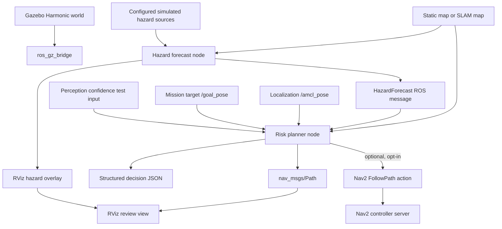

# System architecture

## Design objective

Separate the mission decision algorithm from ROS 2 transport, simulator setup and visualization so algorithmic behavior can be tested deterministically without a running simulator.

## Component graph

The diagram shows intended integration boundaries. The pure core and ROS adapter source exist in the starter. The full Nav2 localization/controller stack is an integration prerequisite, not something the default launch silently pretends to supply.

## Package responsibilities

### `aegisnav_core`

- `models.py`: immutable typed domain objects and validation.
- `forecast.py`: deterministic multi-step hazard field forecast.
- `planning.py`: time-indexed A* over `(cell, time_layer)` states.
- `mission.py`: policy that chooses continue, return, refuge, reassess or abort.
- `evaluation.py`: serializable metrics records.
- `scenarios.py`: deterministic 24 × 16 rescue corridor scenario.
- `svg_report.py`: dependency-free visualization of map, hazard and routes.
- `cli.py`: local deterministic demo and artifact generation.

The core may not import `rclpy`, Gazebo APIs, ROS message types, plotting libraries or web clients.

### `aegisnav_msgs`

`HazardForecast.msg` transports ordered forecast layers. It contains a header, a time step, risk layers and uncertainty layers. Each layer uses an `OccupancyGrid` for shape/origin metadata and integer data encoded as percentages `[0, 100]`; `-1` is reserved for unknown at external message boundaries. The static map remains separate.

### `aegisnav_ros`

- `hazard_forecast_node.py`: reads a traversability map, evolves configured synthetic hazard sources and publishes forecast layers plus an RViz `MarkerArray`.
- `planner_node.py`: converts map/forecast/pose/goal messages into core models, assesses mission feasibility, publishes a route and JSON decision, and provides an opt-in Nav2 `FollowPath` action client.
- `ros_grid.py`: strict boundary conversions and coordinate helpers.

ROS callbacks should parse/validate, call domain services, then publish. They must not re-implement the route objective.

### `aegisnav_bringup`

- a fixed-grid sample SDF world and small differential-drive model;
- a static occupancy map aligned with the sample grid;
- Gazebo/ROS topic bridge and map server launch;
- RViz display configuration.

The SDF fire/smoke objects are visual anchors. Dynamic risk is represented in ROS forecast layers; the default RViz overlay is not the same as a photorealistic Gazebo camera effect.

## Mission decision flow

1. Validate map, target, pose and the forecast-layer count/shapes.
2. Convert pose and target to cells in the map frame.
3. Plan current-to-target using time-indexed risk and uncertainty.
4. Estimate the target arrival time from the route's number of steps.
5. Plan target-to-base using the forecast time layer at expected arrival.
6. Apply perception-confidence gates and exposure budgets.
7. If the mission fails a constraint, compare current-to-refuge or current-to-base alternatives.
8. Publish decision `action`, `reason_code`, explanation and route metrics.
9. Publish the selected route for inspection; execute it only if explicit Nav2 integration is enabled.

## Planner objective

For each legal move, the core uses a base distance term plus risk and uncertainty penalties:

\[
J(P) = D(P) + w_h H(P) + w_u U(P)
\]

where `D` is path distance, `H` is the time-integrated normalized risk exposure, and `U` is time-integrated uncertainty. Risk above the hard cutoff is forbidden independently of the soft weights. The heuristic is octile distance for diagonal movement and ignores non-negative risk penalties, maintaining admissibility for the chosen movement geometry.

## Current constraints and deliberate non-goals

- The simulation forecast is a deterministic diffusion-like rule, not fire dynamics or toxic-gas fluid simulation.
- The ROS grid converter currently rejects rotated `OccupancyGrid` origins rather than silently applying incorrect coordinates.
- The initial RViz marker layer shows a selected future forecast frame. It does not inject visual effects into the Gazebo renderer.
- Confidence is an external normalized test signal, not an internally calibrated vision model.
- A* plans against a provided grid and forecast; it is not a replacement for Nav2's local collision controller or emergency stop.
- This repository does not claim certification, deployment readiness or real-world rescue reliability.
